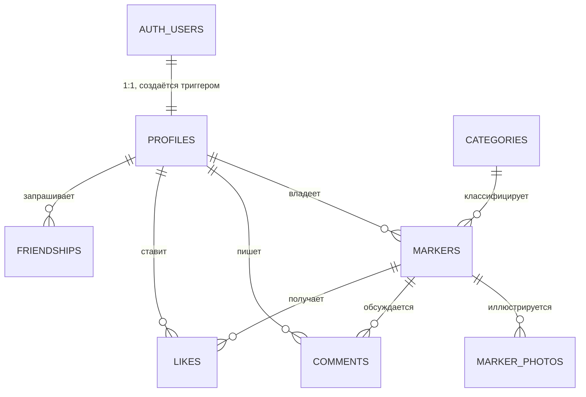

# База данных

Схема целиком описана миграциями в [`supabase/migrations/`](../supabase/migrations). Здесь — карта модели и правила доступа.

## Связи

`auth.users` — таблица GoTrue, приложению она нужна только как источник `id` и почты. В `profiles` почты нет намеренно: её не требуется показывать другим пользователям.

## Таблицы

| Таблица | Назначение | Ключевые ограничения |
| --- | --- | --- |
| `profiles` | публичный профиль | ник `^[A-Za-z0-9_]{3,30}$`, уникален без учёта регистра |
| `categories` | справочник категорий | `slug` уникален, 8 записей в сиде |
| `markers` | точки на карте | `lat` ∈ [−90, 90], `lng` ∈ [−180, 180], `visibility` ∈ {public, friends, private} |
| `marker_photos` | фото меток | путь в Storage уникален |
| `comments` | комментарии | длина 1…1000 |
| `likes` | лайки | PK `(marker_id, user_id)` — один лайк на пользователя |
| `friendships` | заявки в друзья | уникальная пара `least/greatest`, `requester ≠ addressee` |

## Функции

| Функция | Тип | Зачем |
| --- | --- | --- |
| `handle_new_user()` | триггер на `auth.users` | создаёт профиль, санитизирует ник, добавляет суффикс при занятости |
| `set_updated_at()` | триггер | обновляет `updated_at` |
| `is_friend(a, b)` | `security definer`, stable | принятая дружба в любую сторону |
| `is_marker_owner(marker, user)` | `security definer`, stable | владелец метки |
| `can_view_marker(marker, user)` | `security definer`, stable | единое правило видимости |

`security definer` здесь не «дыра»: функции возвращают только `boolean`, имеют фиксированный `search_path` и не принимают SQL-фрагментов. Зато политики не зацикливаются: политика на `friendships` не перечитывает `friendships` через RLS.

## Кто что видит

Функция `can_view_marker` проверяет три условия: владелец, открытый профиль с публичной меткой, друг с меткой `public`/`friends`.

| Наблюдатель | `public`, открытый профиль | `friends` | `private` | `public`, закрытый профиль |
| --- | --- | --- | --- | --- |
| гость | да | нет | нет | нет |
| владелец | да | да | да | да |
| друг | да | да | нет | да |
| посторонний авторизованный | да | нет | нет | нет |

## Индексы

- `profiles_username_lower_key` — уникальность ника без учёта регистра.
- `profiles_username_trgm_idx`, `markers_title_trgm_idx`, `markers_description_trgm_idx` — `pg_trgm` для `ILIKE '%…%'`.
- `markers_owner_idx`, `markers_category_idx`, `markers_visibility_idx`, `markers_created_at_idx`.
- `friendships_pair_key` — уникальность пары.
- `profiles_is_private_idx` — частичный индекс по закрытым профилям.

## Storage

| Bucket | Приватность | Путь | Кто пишет |
| --- | --- | --- | --- |
| `marker-photos` | приватный | `{owner_id}/{marker_id}/{uuid}.{ext}` | владелец метки |
| `avatars` | публичный | `{user_id}/avatar-{timestamp}.{ext}` | владелец профиля |

Фото меток отдаются только через `createSignedUrl`, поэтому ссылка живёт час и выдаётся после проверки `can_view_marker`. Это закрывает сценарий «угадал путь — увидел фото закрытой метки».

Аватары лежат в публичном bucket: это часть публичного профиля, она и так видна в списках и на карте. Ограничения: 2 МБ, `image/jpeg`, `image/png`, `image/webp`.

Ограничения `marker-photos`: 5 МБ, `image/jpeg`, `image/png`, `image/webp`, `image/gif`.

## Realtime

В публикацию `supabase_realtime` добавлены `markers`, `comments`, `likes`. Клиент подписан на изменения `markers`; при событии список перезапрашивается — это проще и надёжнее, чем собирать состояние из отдельных payload'ов.

## Миграции

Порядок важен: расширения → таблицы → функции → RLS → Storage → гранты → приватность → права на фото. Все файлы идемпотентны: повторный прогон не ломает базу, `drop policy if exists` стоит перед каждым `create policy`.
